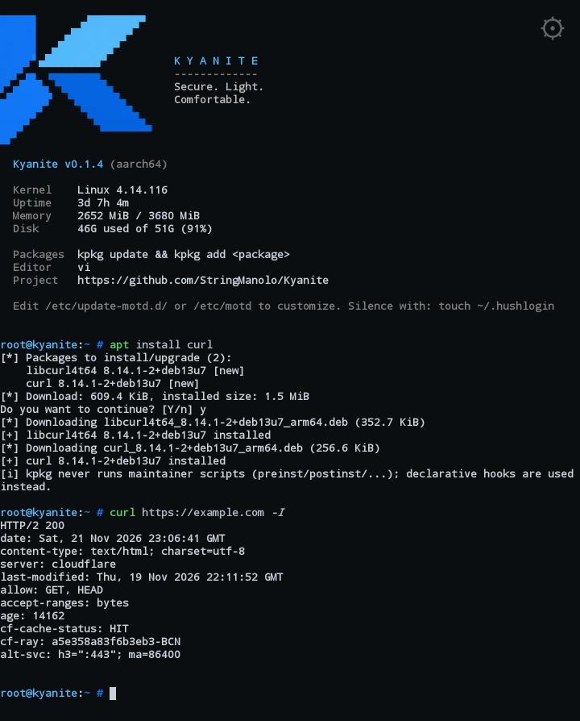

🇪🇸 Español | [🇺🇸 English](README.md) | [🇷🇺 Русский](README.ru.md) | [🇨🇳 简体中文](README.zh-CN.md)

# Kyanite

Kyanite es un sistema Linux pequeño, fácil de llevar y fácil de usar. Sus herramientas principales están escritas en Rust, un lenguaje de programación que ayuda a evitar muchos errores comunes de memoria. Puedes instalar miles de programas adicionales de Debian con un solo comando.



[](https://github.com/StringManolo/Kyanite/actions/workflows/build-rootfs.yml)

## En resumen

- **Pequeño:** un sistema base compacto, rápido de descargar y de arrancar.
- **Más seguro por diseño:** el sistema de inicio, el gestor de paquetes, la shell y los comandos básicos están escritos en Rust.
- **Mucho software:** `kpkg` instala programas desde los repositorios de Debian.
- **Familiar:** comandos habituales y una shell interactiva, listos para usar.
- **Funciona como una app:** no reemplaza tu sistema operativo. En Android es una app normal; en Linux funciona dentro de una carpeta.

¿Eres nuevo en Linux? El [glosario](docs/es/glossary.md) explica en lenguaje sencillo las palabras técnicas que aparecen aquí.

## Obtener Kyanite

### En Android (lo más fácil)

1. [**Descarga Kyanite para Android (.apk)**](https://github.com/StringManolo/KyaniteAndroid/releases/latest/download/Kyanite.apk)
2. Abre el archivo descargado e instálalo (Android puede pedirte que permitas instalar apps desde este origen).
3. Abre la app y elige cómo iniciar Kyanite en la primera pantalla.

Más detalles en la [guía de Android](docs/es/android.md). Código fuente: [KyaniteAndroid](https://github.com/StringManolo/KyaniteAndroid).

### En Linux

Descarga un archivo del sistema de archivos raíz desde la [página de Releases](https://github.com/StringManolo/Kyanite/releases). Hay tres arquitecturas disponibles:

- `aarch64` (ARM64)
- `x86_64` (AMD64)
- `armv7` (ARM de 32 bits)

Cada versión incluye el archivo, su suma de comprobación SHA256 y una firma, para que puedas comprobar que la descarga es auténtica. Sigue la [guía de instalación](docs/es/installation.md) paso a paso.

¿Prefieres una máquina virtual o una memoria USB? También hay imágenes de disco x86_64 listas para usar, para QEMU, memorias USB y una ISO live. Consulta la [guía de imágenes x86_64](docs/es/x86_64-images.md). Por ejemplo, con QEMU:

```sh
qemu-system-x86_64 -m 1G -drive file=kyanite-x86_64.img,format=raw
```

### En Windows

Kyanite tiene imágenes de disco x86_64 que funcionan con los programas habituales de Windows. Descárgalas desde la release [x86_64 images for PC/Windows/Linux, QEMU, VirtualBox, VMware, etc.](https://github.com/StringManolo/Kyanite/releases/tag/qemuTest).

| Programa | Archivo |
| --- | --- |
| VirtualBox | `kyanite-x86_64.vdi` |
| VMware | `kyanite-x86_64.vmdk` |
| Rufus (para arrancar un PC real desde una memoria USB, en modo «DD Image») | `kyanite-x86_64-hw-live.iso`, o `kyanite-x86_64-hw.img.zip` (extráelo antes) |

Antes de arrancar un PC real, lee la [guía de imágenes x86_64](docs/es/x86_64-images.md): Secure Boot debe estar desactivado y el instalador todavía no se ha probado en hardware real.

### Con proot (en cualquier entorno Linux)

[proot](https://proot-me.github.io/) ejecuta un sistema de archivos raíz como usuario normal: sin root y sin modificar tu sistema. Funciona en la mayoría de entornos Linux, incluidas las distribuciones normales, Android (Termux), WSL y muchos contenedores (siempre que `ptrace` esté permitido). La app de Kyanite para Android también lo usa.

```sh
mkdir kyanite
tar -xpf kyanite-rootfs-x86_64.tar.xz -C kyanite    # en ARM de 64 bits usa el archivo aarch64; en ARM de 32 bits, el armv7

proot -0 -r kyanite -b /dev -b /proc -b /sys -w /root \
  /usr/bin/env -i HOME=/root TERM="$TERM" LANG=C.UTF-8 \
  PATH=/usr/local/sbin:/usr/local/bin:/usr/sbin:/usr/bin:/sbin:/bin \
  /bin/sh -l
```

### En Termux

Hay dos formas, ambas sin root.

**Con proot-distro** (rápido: ejecuta Kyanite directamente en tu móvil). Ejecuta esto una sola vez para registrar Kyanite como distribución personalizada (elige el archivo que corresponde a tu móvil):

```sh
NAME=kyanite
BASE=https://github.com/StringManolo/Kyanite/releases/latest/download
: "${PREFIX:?run this inside Termux}"

# Archive name for this phone (dpkg uses Termux's own architecture names: aarch64, arm, x86_64)
case "$(dpkg --print-architecture)" in
  aarch64) ARCH=aarch64 ;;
  arm)     ARCH=armv7 ;;
  x86_64)  ARCH=x86_64 ;;
  *) echo "Unsupported architecture: $(dpkg --print-architecture)" >&2; exit 1 ;;
esac
FILE="kyanite-rootfs-$ARCH.tar.xz"

pkg install -y proot-distro curl

if [ -d "$PREFIX/var/lib/proot-distro/containers/$NAME" ]; then
  echo "Kyanite is already installed (remove it first with: proot-distro remove $NAME)."
else
  TMP=$(mktemp -d)
  trap 'rm -rf "$TMP"' EXIT
  echo "Downloading $FILE ..."
  curl -fL --progress-bar -o "$TMP/$FILE" "$BASE/$FILE"
  curl -fsSL -o "$TMP/$FILE.sha256" "$BASE/$FILE.sha256"
  echo "Checking the SHA256 checksum ..."
  (cd "$TMP" && sha256sum -c "$FILE.sha256")
  proot-distro install "$TMP/$FILE" --name "$NAME"
fi

# `kyanite`          -> opens a shell
# `kyanite COMMAND`  -> runs COMMAND and exits
cat > "$PREFIX/bin/kyanite" <<LAUNCHER
#!$PREFIX/bin/sh
if [ "\$#" -eq 0 ]; then
  exec proot-distro login $NAME
else
  exec proot-distro login $NAME -- "\$@"
fi
LAUNCHER
chmod 755 "$PREFIX/bin/kyanite"

echo
echo "Done. Type  kyanite  to start it."
echo "To remove it:  proot-distro remove $NAME && rm \"$PREFIX/bin/kyanite\""
```

Después, cada vez que quieras usarlo:

```sh
kyanite
```

**Con QEMU** (lento: emula un PC entero, pero te permite probar las imágenes x86_64):

```sh
pkg install qemu-system-x86-64-headless unzip curl
curl -LO https://github.com/StringManolo/Kyanite/releases/download/qemuTest/kyanite-x86_64.img.zip
unzip kyanite-x86_64.img.zip
qemu-system-x86_64 -m 1G -drive file=kyanite-x86_64.img,format=raw -vnc 127.0.0.1:0
```

Luego abre una app de visor VNC en el móvil y conéctate a `127.0.0.1:5900`. Hay otras formas de mostrar la pantalla en la [guía de imágenes x86_64](docs/es/x86_64-images.md).

## Tus primeros pasos

Cuando Kyanite esté en marcha, puedes probar algunos comandos básicos:

```sh
pwd        # muestra la carpeta en la que estás
ls         # lista los archivos de esta carpeta
cd /etc    # te mueve a otra carpeta
```

Para instalar software, usa `kpkg`:

```sh
kpkg update
kpkg add curl
```

La [guía de uso](docs/es/usage.md) y la [guía de kpkg](docs/es/kpkg.md) tienen más ejemplos.

## ¿Qué incluye?

| Componente | Qué hace |
| --- | --- |
| `kyanite-init` | Arranca el sistema y abre la shell |
| [Brush](https://github.com/reubeno/brush) | La shell: el programa donde escribes los comandos |
| [uutils coreutils](https://github.com/uutils/coreutils) | Comandos de uso diario como `ls` y `cp`, escritos en Rust |
| `kpkg` | El gestor de paquetes: instala y elimina programas de Debian |
| Runtime glibc | Permite ejecutar programas de Debian |
| `vi` | Un editor de texto sencillo |

¿Quieres saber cómo encajan las piezas? Lee la [guía de arquitectura](docs/es/architecture.md).

## Documentación

| Guía | Qué cubre |
| --- | --- |
| [Glosario](docs/es/glossary.md) | Palabras técnicas explicadas en lenguaje sencillo |
| [Guía de Android](docs/es/android.md) | Usar Kyanite en tu móvil |
| [Instalación](docs/es/installation.md) | Descargar, verificar e iniciar Kyanite |
| [Imágenes x86_64](docs/es/x86_64-images.md) | Imágenes de disco para PC y máquinas virtuales (QEMU, VirtualBox, VMware) |
| [Uso](docs/es/usage.md) | Entorno de shell y personalización |
| [Gestor de paquetes (`kpkg`)](docs/es/kpkg.md) | Comandos, opciones y gestión de paquetes |
| [Hooks de paquetes](docs/es/package-hooks.md) | Cómo configura Kyanite los paquetes |
| [Arquitectura](docs/es/architecture.md) | Componentes y diseño del sistema |
| [Desarrollo](docs/es/development.md) | Compilar y trabajar con el código fuente |
| [Versiones](docs/es/releases.md) | Versionado y proceso de publicación |
| [Limitaciones conocidas](docs/es/limitations.md) | Notas de compatibilidad y limitaciones técnicas actuales |
| [Hoja de ruta](docs/es/roadmap.md) | Áreas en estudio y posibles mejoras futuras |

## Seguridad

La seguridad es un objetivo importante del diseño. [SECURITY.md](SECURITY.md) (en inglés) describe el modelo de amenazas, las protecciones ya implementadas, las carencias conocidas y cómo informar de una vulnerabilidad.

## Contribuir

Kyanite se desarrolla de forma abierta. La [guía de desarrollo](docs/es/development.md) explica cómo compilar el proyecto y por dónde empezar.
