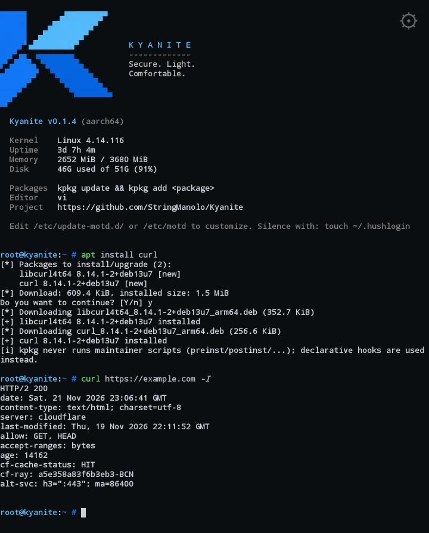

🇺🇸 English | [🇪🇸 Español](README.es.md) | [🇷🇺 Русский](README.ru.md) | [🇨🇳 简体中文](README.zh-CN.md)

# Kyanite

Kyanite is a small Linux system that is easy to carry and easy to use. Its core tools are written in Rust, a programming language that helps avoid many common memory bugs. You can install thousands of extra programs from Debian with a single command.



[](https://github.com/StringManolo/Kyanite/actions/workflows/build-rootfs.yml)

## In short

- **Small:** a compact base system, quick to download and start.
- **Safer by design:** the init system, package manager, shell and core commands are written in Rust.
- **Lots of software:** `kpkg` installs programs from Debian's repositories.
- **Familiar:** common commands and an interactive shell, ready to use.
- **Runs as an app:** it does not replace your operating system. On Android it is a normal app; on Linux it runs inside a folder.

New to Linux? The [glossary](docs/glossary.md) explains the technical words used here.

## Get Kyanite

### On Android (easiest)

1. [**Download Kyanite for Android (.apk)**](https://github.com/StringManolo/KyaniteAndroid/releases/latest/download/Kyanite.apk)
2. Open the downloaded file and install it (Android may ask you to allow installing apps from this source).
3. Open the app and choose how to start Kyanite on the first screen.

More details in the [Android guide](docs/android.md). Source code: [KyaniteAndroid](https://github.com/StringManolo/KyaniteAndroid).

### On Linux

Download a root filesystem archive from the [Releases page](https://github.com/StringManolo/Kyanite/releases). Two architectures are available:

- `aarch64` (ARM64)
- `x86_64` (AMD64)

Each release includes the archive, its SHA256 checksum and a signature, so you can check that the download is genuine. Follow the [installation guide](docs/installation.md) step by step.

## Your first steps

Once Kyanite is running, you can try a few basic commands:

```sh
pwd        # show the folder you are in
ls         # list the files in this folder
cd /etc    # move to another folder
```

To install software, use `kpkg`:

```sh
kpkg update
kpkg add curl
```

The [usage guide](docs/usage.md) and the [kpkg guide](docs/kpkg.md) have more examples.

## What is included?

| Component | What it does |
| --- | --- |
| `kyanite-init` | Starts the system and opens the shell |
| [Brush](https://github.com/reubeno/brush) | The shell: the program where you type commands |
| [uutils coreutils](https://github.com/uutils/coreutils) | Everyday commands such as `ls` and `cp`, written in Rust |
| `kpkg` | The package manager: installs and removes programs from Debian |
| glibc runtime | Lets Debian programs run |
| `vi` | A simple text editor |

Want to know how the pieces fit together? Read the [architecture guide](docs/architecture.md).

## Documentation

| Guide | What it covers |
| --- | --- |
| [Glossary](docs/glossary.md) | Technical words explained in plain language |
| [Android guide](docs/android.md) | Using Kyanite on your phone |
| [Installation](docs/installation.md) | Downloading, verifying and starting Kyanite |
| [Usage](docs/usage.md) | Shell environment and customization |
| [Package manager (`kpkg`)](docs/kpkg.md) | Commands, options and package management |
| [Package hooks](docs/package-hooks.md) | How Kyanite configures packages |
| [Architecture](docs/architecture.md) | Components and system design |
| [Development](docs/development.md) | Building and working on the source |
| [Releases](docs/releases.md) | Versioning and release process |
| [Known limitations](docs/limitations.md) | Current compatibility notes and technical limitations |
| [Roadmap](docs/roadmap.md) | Areas being explored and possible future improvements |

## Security

Security is an important design goal. [SECURITY.md](SECURITY.md) (in English) describes the threat model, the protections already in place, known gaps and how to report a vulnerability.

## Contributing

Kyanite is developed in the open. The [development guide](docs/development.md) explains how to build the project and where to start.
