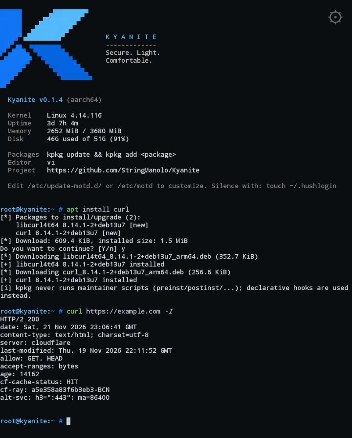

🇷🇺 Русский | [🇺🇸 English](README.md) | [🇪🇸 Español](README.es.md) | [🇨🇳 简体中文](README.zh-CN.md)

# Kyanite

Kyanite — это небольшая Linux-система, которую легко носить с собой и легко использовать. Её основные инструменты написаны на Rust — языке программирования, который помогает избежать многих распространённых ошибок работы с памятью. Одной командой вы можете установить тысячи дополнительных программ из Debian.



[](https://github.com/StringManolo/Kyanite/actions/workflows/build-rootfs.yml)

## Коротко

- **Небольшая:** компактная базовая система, которую быстро скачать и запустить.
- **Безопаснее по замыслу:** система инициализации, менеджер пакетов, оболочка и основные команды написаны на Rust.
- **Много программ:** `kpkg` устанавливает программы из репозиториев Debian.
- **Привычная:** обычные команды и интерактивная оболочка — всё готово к работе.
- **Работает как приложение:** она не заменяет вашу операционную систему. На Android это обычное приложение, на Linux — работает внутри папки.

Впервые видите Linux? [Глоссарий](docs/ru/glossary.md) простым языком объясняет технические слова, которые здесь встречаются.

## Как получить Kyanite

### На Android (проще всего)

1. [**Скачайте Kyanite для Android (.apk)**](https://github.com/StringManolo/KyaniteAndroid/releases/latest/download/Kyanite.apk)
2. Откройте скачанный файл и установите его (Android может попросить разрешить установку приложений из этого источника).
3. Откройте приложение и на первом экране выберите, как запускать Kyanite.

Подробности — в [руководстве по Android](docs/ru/android.md). Исходный код: [KyaniteAndroid](https://github.com/StringManolo/KyaniteAndroid).

### На Linux

Скачайте архив корневой файловой системы на [странице Releases](https://github.com/StringManolo/Kyanite/releases). Доступны три архитектуры:

- `aarch64` (ARM64)
- `x86_64` (AMD64)
- `armv7` (32-битный ARM)

Каждый релиз включает архив, его контрольную сумму SHA256 и подпись, чтобы вы могли убедиться в подлинности загрузки. Следуйте [руководству по установке](docs/ru/installation.md) шаг за шагом.

Хотите виртуальную машину или USB-накопитель? Есть также готовые образы дисков x86_64 — для QEMU, USB-накопителей и live-ISO. См. [руководство по образам x86_64](docs/ru/x86_64-images.md). Например, с QEMU:

```sh
qemu-system-x86_64 -m 1G -drive file=kyanite-x86_64.img,format=raw
```

### На Windows

У Kyanite есть образы дисков x86_64, которые работают с привычными программами для Windows. Скачайте их в релизе [x86_64 images for PC/Windows/Linux, QEMU, VirtualBox, VMware, etc.](https://github.com/StringManolo/Kyanite/releases/tag/qemuTest).

| Программа | Файл |
| --- | --- |
| VirtualBox | `kyanite-x86_64.vdi` |
| VMware | `kyanite-x86_64.vmdk` |
| Rufus (чтобы загрузить настоящий ПК с USB-накопителя, режим «DD Image») | `kyanite-x86_64-hw-live.iso` или `kyanite-x86_64-hw.img.zip` (сначала распакуйте) |

Перед загрузкой настоящего ПК прочитайте [руководство по образам x86_64](docs/ru/x86_64-images.md): Secure Boot должен быть отключён, а установщик пока не проверен на реальном оборудовании.

### С proot (в любой среде Linux)

[proot](https://proot-me.github.io/) запускает корневую файловую систему от имени обычного пользователя: без root и без изменений в вашей системе. Он работает в большинстве сред Linux: в обычных дистрибутивах, Android (Termux), WSL и многих контейнерах (если разрешён `ptrace`). Приложение Kyanite для Android тоже использует его.

```sh
mkdir kyanite
tar -xpf kyanite-rootfs-x86_64.tar.xz -C kyanite    # на 64-битном ARM берите архив aarch64, на 32-битном — armv7

proot -0 -r kyanite -b /dev -b /proc -b /sys -w /root \
  /usr/bin/env -i HOME=/root TERM="$TERM" LANG=C.UTF-8 \
  PATH=/usr/local/sbin:/usr/local/bin:/usr/sbin:/usr/bin:/sbin:/bin \
  /bin/sh -l
```

### В Termux

Есть два способа, оба без root.

**Через proot-distro** (быстро: Kyanite запускается прямо на телефоне). Выполните это один раз, чтобы зарегистрировать Kyanite как пользовательский дистрибутив (он сам выбирает архив для вашего телефона):

```sh
pkg install proot-distro curl
PD=$(dpkg --print-architecture)                 # aarch64, arm or x86_64
case "$PD" in arm) A=armv7 ;; *) A=$PD ;; esac  # name used by the Kyanite archives
URL=https://github.com/StringManolo/Kyanite/releases/latest/download/kyanite-rootfs-$A.tar.xz
SHA=$(curl -fsSL "$URL.sha256" | cut -d' ' -f1)
cat > "$PREFIX/etc/proot-distro/kyanite.sh" <<EOF
DISTRO_NAME="Kyanite"
TARBALL_STRIP_OPT=0
TARBALL_URL['$PD']="$URL"
TARBALL_SHA256['$PD']="$SHA"
EOF
proot-distro install kyanite
```

Затем каждый раз, когда нужно:

```sh
proot-distro login kyanite -- /bin/sh -l
```

**Через QEMU** (медленно: эмулируется целый ПК, зато можно попробовать образы x86_64):

```sh
pkg install qemu-system-x86-64-headless unzip curl
curl -LO https://github.com/StringManolo/Kyanite/releases/download/qemuTest/kyanite-x86_64.img.zip
unzip kyanite-x86_64.img.zip
qemu-system-x86_64 -m 1G -drive file=kyanite-x86_64.img,format=raw -vnc 127.0.0.1:0
```

Затем откройте на телефоне приложение-клиент VNC и подключитесь к `127.0.0.1:5900`. Другие способы показать экран описаны в [руководстве по образам x86_64](docs/ru/x86_64-images.md).

## Первые шаги

Когда Kyanite запущена, попробуйте несколько простых команд:

```sh
pwd        # показать папку, в которой вы находитесь
ls         # показать файлы в этой папке
cd /etc    # перейти в другую папку
```

Чтобы установить программу, используйте `kpkg`:

```sh
kpkg update
kpkg add curl
```

Больше примеров — в [руководстве по использованию](docs/ru/usage.md) и [документации по kpkg](docs/ru/kpkg.md).

## Что входит в состав?

| Компонент | Что делает |
| --- | --- |
| `kyanite-init` | Запускает систему и открывает оболочку |
| [Brush](https://github.com/reubeno/brush) | Оболочка: программа, в которой вы вводите команды |
| [uutils coreutils](https://github.com/uutils/coreutils) | Повседневные команды, такие как `ls` и `cp`, написанные на Rust |
| `kpkg` | Менеджер пакетов: устанавливает и удаляет программы из Debian |
| Среда выполнения glibc | Позволяет запускать программы из Debian |
| `vi` | Простой текстовый редактор |

Хотите узнать, как всё это устроено? Прочитайте [описание архитектуры](docs/ru/architecture.md).

## Документация

| Руководство | О чём |
| --- | --- |
| [Глоссарий](docs/ru/glossary.md) | Технические слова простым языком |
| [Руководство по Android](docs/ru/android.md) | Использование Kyanite на телефоне |
| [Установка](docs/ru/installation.md) | Загрузка, проверка и запуск Kyanite |
| [Образы x86_64](docs/ru/x86_64-images.md) | Образы дисков для ПК и виртуальных машин (QEMU, VirtualBox, VMware) |
| [Использование](docs/ru/usage.md) | Окружение оболочки и настройка |
| [Менеджер пакетов (`kpkg`)](docs/ru/kpkg.md) | Команды, параметры и управление пакетами |
| [Хуки пакетов](docs/ru/package-hooks.md) | Как Kyanite настраивает пакеты |
| [Архитектура](docs/ru/architecture.md) | Компоненты и устройство системы |
| [Разработка](docs/ru/development.md) | Сборка и работа с исходным кодом |
| [Релизы](docs/ru/releases.md) | Версионирование и процесс выпуска |
| [Известные ограничения](docs/ru/limitations.md) | Текущие заметки о совместимости и технические ограничения |
| [Дорожная карта](docs/ru/roadmap.md) | Исследуемые направления и возможные улучшения |

## Безопасность

Безопасность — важная цель проекта. В [SECURITY.md](SECURITY.md) (на английском) описаны модель угроз, уже реализованные меры защиты, известные пробелы и порядок сообщения об уязвимостях.

## Участие в разработке

Kyanite разрабатывается открыто. [Руководство по разработке](docs/ru/development.md) объясняет, как собрать проект и с чего начать.
