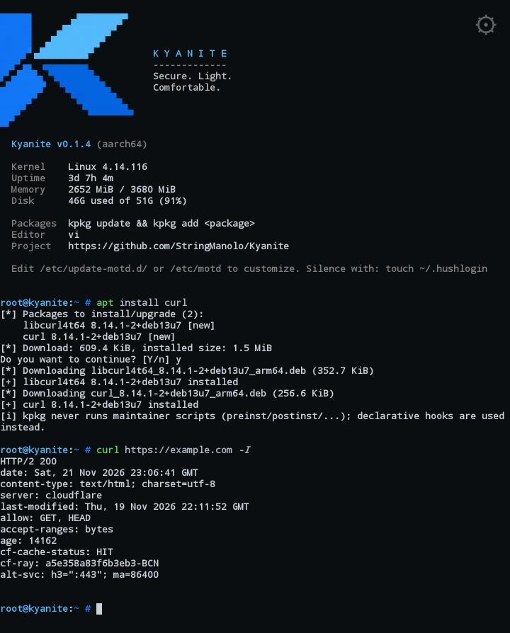

🇨🇳 简体中文 | [🇺🇸 English](README.md) | [🇪🇸 Español](README.es.md) | [🇷🇺 Русский](README.ru.md)

# Kyanite

Kyanite 是一个小巧的 Linux 系统，便于携带，也易于使用。它的核心工具用 Rust 编写。Rust 是一种有助于避免许多常见内存错误的编程语言。只需一条命令，你就可以从 Debian 安装数以千计的额外程序。



[](https://github.com/StringManolo/Kyanite/actions/workflows/build-rootfs.yml)

## 简介

- **小巧：** 精简的基础系统，下载和启动都很快。
- **设计上更安全：** init 系统、包管理器、shell 和核心命令都用 Rust 编写。
- **软件丰富：** `kpkg` 可以从 Debian 软件源安装程序。
- **熟悉易用：** 常用命令和交互式 shell，开箱即用。
- **以应用形式运行：** 它不会替换你的操作系统。在 Android 上它是一个普通应用；在 Linux 上它在一个文件夹中运行。

刚接触 Linux？[术语表](docs/zh-CN/glossary.md)用通俗的语言解释了这里出现的技术词汇。

## 获取 Kyanite

### 在 Android 上（最简单）

1. 下载适用于 Android 的 Kyanite (.apk)：
   - [**64 位**（大多数手机）](https://github.com/StringManolo/KyaniteAndroid/releases/latest/download/Kyanite.apk)
   - [32 位（较旧的手机）](https://github.com/StringManolo/KyaniteAndroid/releases/latest/download/kyanite_v7.apk)
2. 打开下载的文件并安装（Android 可能会要求你允许从此来源安装应用）。
3. 打开应用，在第一个界面选择如何启动 Kyanite。

不确定该下载哪个？[Kyanite 网站](https://stringmanolo.github.io/KyaniteAndroid/zh-CN/)会为你推荐合适的版本；如果其中一个无法安装，请试试另一个。更多详情请见 [Android 指南](docs/zh-CN/android.md)。源代码：[KyaniteAndroid](https://github.com/StringManolo/KyaniteAndroid)。

### 在 Windows 上

在 VirtualBox、VMware 或 QEMU 中运行 Kyanite，或用 Rufus 从 U 盘启动真实电脑。请参阅 [Windows 指南](docs/zh-CN/installation.md#windows)。

### 在 Linux 上

从 [Releases 页面](https://github.com/StringManolo/Kyanite/releases)下载根文件系统压缩包。提供三种架构：

- `aarch64` (ARM64)
- `x86_64` (AMD64)
- `armv7`（32 位 ARM）

每个版本都包含压缩包、它的 SHA256 校验和以及签名，方便你确认下载内容是真实的。请按照 [Linux 指南](docs/zh-CN/installation.md#linux)一步一步操作。你也可以使用 [Docker](docs/zh-CN/installation.md#docker)。

### 在 Termux 中

在 Termux 中通过 proot-distro 或 QEMU，在手机上运行 Kyanite。请参阅 [Termux 指南](docs/zh-CN/installation.md#termux)。

## 第一步

Kyanite 运行起来后，可以试试几个基本命令：

```sh
pwd        # 显示你当前所在的文件夹
ls         # 列出当前文件夹中的文件
cd /etc    # 进入另一个文件夹
```

要安装软件，请使用 `kpkg`：

```sh
kpkg update
kpkg add curl
```

[使用指南](docs/zh-CN/usage.md)和 [kpkg 文档](docs/zh-CN/kpkg.md)中有更多示例。

## 包含哪些组件？

| 组件 | 作用 |
| --- | --- |
| `kyanite-init` | 启动系统并打开 shell |
| [Brush](https://github.com/reubeno/brush) | Shell：你输入命令的程序 |
| [uutils coreutils](https://github.com/uutils/coreutils) | `ls`、`cp` 等日常命令，用 Rust 编写 |
| `kpkg` | 包管理器：从 Debian 安装和卸载程序 |
| glibc 运行时 | 让 Debian 程序能够运行 |
| `vi` | 一个简单的文本编辑器 |

想了解这些部分是如何配合工作的？请阅读[架构指南](docs/zh-CN/architecture.md)。

## 文档

| 指南 | 内容 |
| --- | --- |
| [术语表](docs/zh-CN/glossary.md) | 用通俗语言解释技术词汇 |
| [Android 指南](docs/zh-CN/android.md) | 在手机上使用 Kyanite |
| [安装](docs/zh-CN/installation.md) | 在 Android、Windows、Linux、Termux 和 Docker 上分步安装 |
| [x86_64 镜像](docs/zh-CN/x86_64-images.md) | 适用于 PC 和虚拟机（QEMU、VirtualBox、VMware）的磁盘镜像 |
| [使用](docs/zh-CN/usage.md) | Shell 环境与自定义 |
| [包管理器 (`kpkg`)](docs/zh-CN/kpkg.md) | 命令、选项和包管理 |
| [包钩子](docs/zh-CN/package-hooks.md) | Kyanite 如何配置软件包 |
| [架构](docs/zh-CN/architecture.md) | 组件与系统设计 |
| [开发](docs/zh-CN/development.md) | 构建与源码开发 |
| [发布](docs/zh-CN/releases.md) | 版本管理与发布流程 |
| [已知限制](docs/zh-CN/limitations.md) | 当前的兼容性说明与技术限制 |
| [路线图](docs/zh-CN/roadmap.md) | 正在探索的方向和可能的未来改进 |

## 安全

安全是项目的重要设计目标。[SECURITY.md](SECURITY.md)（英文）介绍了威胁模型、已实现的防护措施、已知缺口以及如何报告漏洞。

## 参与贡献

Kyanite 以开放方式开发。[开发指南](docs/zh-CN/development.md)介绍了如何构建项目以及从哪里入手。
